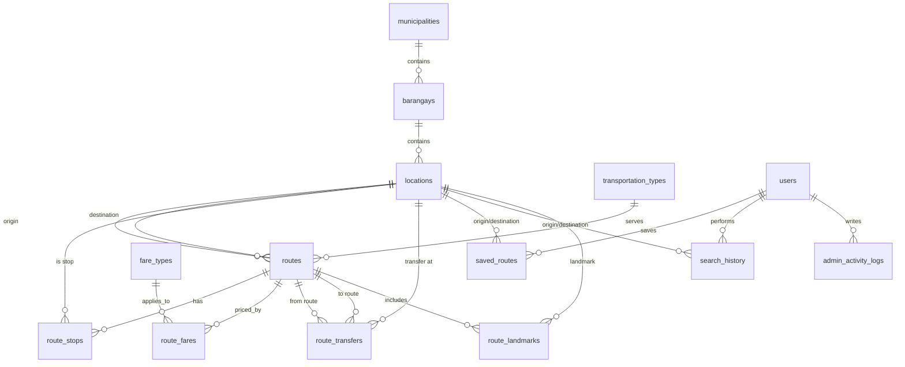

# SakayGuide Database Design

**Project:** SakayGuide: A Web-Based Public Transportation Route and Fare Information System for Local Commuters  
**Database:** `sakayguide_db`  
**DBMS:** MySQL 8.x or MariaDB 10.4+ (XAMPP)  
**Engine:** InnoDB  
**Character set:** `utf8mb4` / `utf8mb4_unicode_ci`

> **Important sample-data notice:** The routes, fares, travel times, and landmark distances in this project are **illustrative test data for one city only** (Butuan City, Agusan del Norte). They are **not official LTFRB, city government, or transport-operator data**. Replace them with verified local data before presenting the system as a real commuter service.

---

## 1. Deliverables

| File | Purpose |
|---|---|
| `sakayguide_db.sql` | Complete runnable script: database creation, 14 tables, constraints, indexes, transfer-validation triggers, sample data, and verification queries. |
| `sakayguide_feature_queries.sql` | SQL for all 14 required features. Read queries run as-is; write examples are commented so importing it does not change sample data. |
| `SAKAYGUIDE_DATABASE.md` | This design document: ERD, table explanations, relationship rules, feature mapping, and phpMyAdmin import instructions. |

The main script is deliberately ordered so it can be imported from top to bottom:

1. Create/use `sakayguide_db`.
2. Drop old SakayGuide tables in dependency order.
3. Create all 14 tables in parent-to-child order.
4. Create the two transfer-validation triggers.
5. Insert sample data in parent-to-child order.
6. Run verification queries.

---

## 2. Database conventions

- All primary keys use `INT UNSIGNED AUTO_INCREMENT` unless there is a reason not to.
- All foreign-key columns use the same `INT UNSIGNED` type as the referenced key.
- All tables use `ENGINE=InnoDB` so foreign keys and transactions work.
- Money uses `DECIMAL(10,2)`, never `FLOAT` or `DOUBLE`.
- Distances use `DECIMAL(8,2)` kilometres; travel/transfer times use whole minutes.
- `DATETIME` is used for account, search, save, and log timestamps.
- Unique keys prevent duplicate emails, duplicate stops, duplicate transfers, duplicate saved pairs, and duplicate fare records for the same route/category/effective date.
- Search indexes cover route origin/destination, stops by location, fare lookups, saved routes, search history, and activity logs.
- Master records such as locations, routes, and fare records are **deactivated** rather than deleted. `ON DELETE RESTRICT` prevents accidental loss of records that are still referenced.
- The application must use PHP **prepared statements** for every query that contains user input.
- Passwords must be stored with `password_hash()` and checked with `password_verify()`. The sample hashes are bcrypt hashes of the documented test passwords.

---

## 3. Entity-relationship diagram (text-based)

### 3.1 Relationship map

```text
municipalities (1) ────< barangays (M) ────< locations (M)

locations (1) ────< routes (M)              [origin_id]
locations (1) ────< routes (M)              [destination_id]
transportation_types (1) ────< routes (M)

routes (1) ────< route_stops (M) >──── (1) locations
routes (1) ────< route_fares (M) >──── (1) fare_types
routes (1) ────< route_transfers (M) >──── (1) locations   [from_route / to_route / transfer_location]
routes (1) ────< route_landmarks (M) >──── (1) locations

users (1) ────< saved_routes (M) >──── (1) locations         [origin / destination]
users (1) ────< search_history (M, user_id nullable) >──── (1) locations
users (1) ────< admin_activity_logs (M)                      [admin_id]
```

### 3.2 ASCII ERD

```text
+----------------------+          +----------------------+          +----------------------+
| municipalities       | 1      * | barangays            | 1      * | locations            |
|----------------------|----------|----------------------|----------|----------------------|
| municipality_id (PK) |----------| municipality_id (FK) |----------| barangay_id (FK)     |
| municipality_name    |          | barangay_name        |          | location_name        |
| province             |          | description          |          | location_type        |
| description          |          +----------------------+          | address              |
| status               |                                            | description          |
+----------------------+                                            | status               |
                                                                    +----------+-----------+
                                                                               |
             +-------------------------+---------------------------+-------------+-------------+------------------+
             |                         |                           |                           |                  |
             | origin / destination    | stops                     | transfers                 | landmarks        | saved/history
             v                         v                           v                           v                  v
   +-------------------+      +-------------------+      +----------------------+      +-------------------+   (users)
   | routes            | 1  * | route_stops       |      | route_transfers      |      | route_landmarks   |
   |-------------------|------|-------------------|      |----------------------|      |-------------------|
   | route_id (PK)     |      | stop_id (PK)      |      | transfer_id (PK)     |      | route_landmark_id |
   | route_name        |      | route_id (FK)     |      | from_route_id (FK)   |      | route_id (FK)     |
   | route_code        |      | location_id (FK)  |      | to_route_id (FK)     |      | location_id (FK)  |
   | origin_id (FK)    |      | stop_order        |      | transfer_location_id |      | description       |
   | destination_id    |      | is_transfer_point |      | instructions         |      | distance_from_... |
   | transport_type_id |      | estimated_stop_.. |      | transfer_time        |      | display_order     |
   | travel_time       |      +-------------------+      | additional_fare      |      +-------------------+
   | status            |                                 +----------------------+
   +---------+---------+
             | 1
             |
      +------+---------------------+
      |                            |
      | *                          | *
+-------------------+      +----------------------+
| route_fares       |      | transportation_types |
|-------------------|      |----------------------|
| fare_id (PK)      |      | transport_type_id PK |
| route_id (FK)     |      | transport_name       |
| fare_type_id (FK) |      | description          |
| minimum_fare      |      | status               |
| fare_per_km       |      +----------+-----------+
| total_estimated.. |                 | 1
| effective_date    |                 |
| expiry_date       |                 | *
| status            |                 |
+---------+---------+                 |
          | *                         |
          | 1                         |
+-------------------+                 |
| fare_types        |                 |
|-------------------|                 |
| fare_type_id (PK) |                 |
| fare_type_name    |                 |
| discount_%        |                 |
| status            |                 |
+-------------------+                 |
                                      |
                         routes has transport_type_id (FK)
```

### 3.3 Mermaid ERD

The following is the same design in Mermaid syntax for tools that render ER diagrams:



### 3.4 Foreign-key and delete rules

| Child table | Foreign key | Referenced table | ON UPDATE | ON DELETE | Reason |
|---|---|---|---|---|---|
| `barangays` | `municipality_id` | `municipalities` | CASCADE | RESTRICT | Do not remove a municipality that still has barangays. |
| `locations` | `barangay_id` | `barangays` | CASCADE | RESTRICT | Do not remove a barangay that still has locations. |
| `routes` | `origin_id` | `locations` | CASCADE | RESTRICT | A route cannot lose its origin silently. |
| `routes` | `destination_id` | `locations` | CASCADE | RESTRICT | A route cannot lose its destination silently. |
| `routes` | `transport_type_id` | `transportation_types` | CASCADE | RESTRICT | Do not remove a transport type used by routes. |
| `route_stops` | `route_id` | `routes` | CASCADE | CASCADE | Stops are owned by a route. |
| `route_stops` | `location_id` | `locations` | CASCADE | RESTRICT | A used location must not be deleted. |
| `route_fares` | `route_id` | `routes` | CASCADE | RESTRICT | Fare history must not disappear with a route. |
| `route_fares` | `fare_type_id` | `fare_types` | CASCADE | RESTRICT | Do not remove a fare category still in use. |
| `route_transfers` | `from_route_id` | `routes` | CASCADE | CASCADE | Transfers are owned by their routes. |
| `route_transfers` | `to_route_id` | `routes` | CASCADE | CASCADE | Transfers are owned by their routes. |
| `route_transfers` | `transfer_location_id` | `locations` | CASCADE | RESTRICT | A used transfer point must not be deleted. |
| `saved_routes` | `user_id` | `users` | CASCADE | CASCADE | A deleted commuter's saved shortcuts are personal data. |
| `saved_routes` | `origin_id`, `destination_id` | `locations` | CASCADE | RESTRICT | Keep referential integrity of saved locations. |
| `search_history` | `user_id` | `users` | CASCADE | SET NULL | History can remain anonymous after account deletion. |
| `search_history` | `origin_id`, `destination_id` | `locations` | CASCADE | RESTRICT | Keep referential integrity of searched locations. |
| `route_landmarks` | `route_id` | `routes` | CASCADE | CASCADE | Landmarks are owned by a route. |
| `route_landmarks` | `location_id` | `locations` | CASCADE | RESTRICT | A used landmark must not be deleted. |
| `admin_activity_logs` | `admin_id` | `users` | CASCADE | RESTRICT | Audit logs must retain their administrator reference. |

Because routes should be deactivated rather than deleted, the `RESTRICT` on `route_fares.route_id` intentionally blocks a hard delete of a route that has any fare history. Administrators use `UPDATE routes SET status = 'inactive'` instead.

---

## 4. Explanation of the 14 tables

### Table 1: `users`
Stores administrator and commuter accounts.

- **Primary key:** `user_id`
- **Unique:** `email`
- **Role:** `ENUM('admin','commuter')`
- **Status:** `active` or `inactive`
- **Security:** `password` stores the output of PHP `password_hash()` (255 characters is enough for current and future algorithms).
- **Index:** `(role, status)` for dashboard counts and account filtering.
- **Timestamps:** `created_at` defaults to the current time; `updated_at` updates automatically.

### Table 2: `municipalities`
Stores the city or municipality covered by the system. Only active records are shown in public searches.

- **Primary key:** `municipality_id`
- **Unique:** `(municipality_name, province)` prevents duplicate coverage entries.
- **Index:** `status`.

### Table 3: `barangays`
Stores barangays under a municipality.

- **Primary key:** `barangay_id`
- **Foreign key:** `municipality_id` → `municipalities`.
- **Unique:** `(municipality_id, barangay_name)`.
- Supports administrator management of the geographic hierarchy.

### Table 4: `locations`
Stores terminals, landmarks, establishments, hospitals, schools, markets, government offices, and other important places.

- **Primary key:** `location_id`
- **Foreign key:** `barangay_id` → `barangays`.
- **Unique:** `(barangay_id, location_name, location_type)`.
- **Indexes:** name, type/status, and barangay.
- A single location can simultaneously be a route origin, route destination, ordered stop, transfer point, landmark, saved-route endpoint, and search-history endpoint. These are separate foreign keys in separate tables, so no duplicate location records are required.
- `location_type` is a `VARCHAR(50)` rather than an ENUM so administrators can add new categories without changing the schema. Recommended values are documented in the column comment.

### Table 5: `transportation_types`
Stores Jeepney, Bus, Tricycle, Multicab, and similar modes.

- **Primary key:** `transport_type_id`
- **Unique:** `transport_name`.
- **Index:** `status`.
- Never hard-delete a type used by routes; set it inactive.

### Table 6: `routes`
Stores each public transport route.

- **Primary key:** `route_id`
- **Unique:** `route_code`.
- **Foreign keys:** `origin_id` and `destination_id` → `locations`; `transport_type_id` → `transportation_types`.
- **Checks:** origin and destination must differ; estimated travel time must be greater than zero.
- **Indexes:** `(origin_id, destination_id)`, destination, transport type, status, and route name.
- `estimated_travel_time` is stored in **minutes**.
- `status='inactive'` is the supported way to retire a route without deleting its stops, fares, transfers, or history.

### Table 7: `route_stops`
Stores the ordered stops along a route.

- **Primary key:** `stop_id`
- **Foreign keys:** `route_id` → `routes`; `location_id` → `locations`.
- **Unique:** `(route_id, stop_order)` ensures a clear sequence; `(route_id, location_id)` prevents the same location appearing twice on one route.
- **Index:** `(location_id, route_id)` is important for origin/destination searches.
- `is_transfer_point` marks stops where transfers are possible.
- `estimated_stop_time` is the estimated elapsed time in minutes from the route origin, not the time spent standing at the stop.

### Table 8: `fare_types`
Defines fare categories.

- **Primary key:** `fare_type_id`
- **Unique:** `fare_type_name`.
- **Check:** `discount_percentage` must be between 0 and 100.
- **Index:** `status`.
- Sample categories: Regular, Student, Senior Citizen, Person with Disability.

### Table 9: `route_fares`
Stores fare amounts for each route and fare category, including fare history.

- **Primary key:** `fare_id`
- **Foreign keys:** `route_id` → `routes`; `fare_type_id` → `fare_types`.
- **Unique:** `(route_id, fare_type_id, effective_date)` prevents two fares for the same route/category starting on the same date.
- **Indexes:** `(route_id, fare_type_id, status, effective_date)` for current-fare lookups; effective/expiry date; status.
- **Checks:** all money values are non-negative; `expiry_date` cannot be before `effective_date`.
- **History rule:** never `DELETE` an old fare. When a fare changes:
  1. Set the old row's `expiry_date` to the day before the new effective date.
  2. Set the old row's `status` to `expired`.
  3. Insert a new active row with a new `effective_date`.
- `total_estimated_fare` is the stored estimated amount for that category. `discount_percentage` in `fare_types` is metadata for display and audit; do not apply the discount twice if the stored total is already discounted.
- Historical and current rows are separated by `effective_date`, `expiry_date`, and `status`.

### Table 10: `route_transfers`
Stores valid connections from one route to another at a shared location.

- **Primary key:** `transfer_id`
- **Foreign keys:** `from_route_id` and `to_route_id` → `routes`; `transfer_location_id` → `locations`.
- **Unique:** `(from_route_id, to_route_id, transfer_location_id)`.
- **Checks:** the two routes must be different; additional fare cannot be negative.
- `transfer_instructions` is the passenger-facing explanation.
- `estimated_transfer_time` is walking/waiting time in minutes.
- `additional_estimated_fare` is any extra fee for the transfer, separate from the second route's fare.
- **Validation:** two `BEFORE INSERT` / `BEFORE UPDATE` triggers reject a transfer unless the transfer location is an existing stop on both routes. The application should also validate that the transfer makes sense in the requested direction (origin before the transfer, destination after it).

### Table 11: `saved_routes`
Stores an origin-destination pair saved by a commuter, with an optional nickname.

- **Primary key:** `saved_route_id`
- **Foreign keys:** `user_id` → `users`; `origin_id` and `destination_id` → `locations`.
- **Unique:** `(user_id, origin_id, destination_id)` prevents duplicate saved pairs for the same commuter.
- **Check:** origin and destination must differ.
- **Indexes:** user/date and origin/destination.
- Saving is done with `INSERT ... ON DUPLICATE KEY UPDATE` so the nickname and timestamp are refreshed instead of creating duplicates.

### Table 12: `search_history`
Stores commuter and guest searches.

- **Primary key:** `search_id`
- **Foreign keys:** `user_id` → `users` (**nullable** for guests); `origin_id` and `destination_id` → `locations`.
- **Check:** origin and destination must differ.
- **Indexes:** `(user_id, search_date)`, `(origin_id, destination_id)`, and `search_date`.
- Guest searches insert `NULL` into `user_id`. When a user account is deleted, history remains with `user_id = NULL` because of `ON DELETE SET NULL`.

### Table 13: `route_landmarks`
Connects a route to important landmarks and describes their position along the route.

- **Primary key:** `route_landmark_id`
- **Foreign keys:** `route_id` → `routes`; `location_id` → `locations`.
- **Unique:** `(route_id, location_id)` and `(route_id, display_order)`.
- **Check:** distance and display order are non-negative/positive.
- `distance_from_origin` is approximate kilometres from the route origin.
- This table is intentionally separate from `route_stops`: a route can pass a landmark without treating it as a boarding stop, and the same location can be described differently for different routes.

### Table 14: `admin_activity_logs`
Records administrator actions for auditability.

- **Primary key:** `log_id`
- **Foreign key:** `admin_id` → `users`.
- **Indexes:** `(admin_id, created_at)`, `(table_affected, record_id)`, and `action_type`.
- `record_id` is the affected row's primary key when applicable. It is intentionally **not** a foreign key because it can point to different tables.
- `action_type` is a `VARCHAR(50)` rather than an ENUM so new administrative actions can be recorded without altering the table.
- Log writes should occur in the same PHP request as the administrative action. The application must verify that the logged-in account has `role='admin'` before inserting.
- `ON DELETE RESTRICT` keeps audit records attached to an administrator account; administrators should be deactivated, not deleted.

---

## 5. Sample data included

One coverage area is populated: **Butuan City, Agusan del Norte**.

| Dataset | Rows | Notes |
|---|---:|---|
| `users` | 3 | 1 administrator, 2 commuters |
| `municipalities` | 1 | Butuan City |
| `barangays` | 10 | Sample barangays |
| `locations` | 18 | Terminals, landmarks, schools, hospitals, malls, government offices |
| `transportation_types` | 3 | Jeepney, Bus, Tricycle |
| `routes` | 6 | Sample active routes |
| `route_stops` | 24 | Ordered stops |
| `fare_types` | 4 | Regular, Student, Senior Citizen, Person with Disability |
| `route_fares` | 25 | Current fares plus one retained historical fare |
| `route_transfers` | 4 | All transfer locations are stops on both routes |
| `saved_routes` | 3 | Commuter shortcuts |
| `search_history` | 6 | Includes one guest search (`user_id = NULL`) |
| `route_landmarks` | 22 | Ordered landmarks per route |
| `admin_activity_logs` | 4 | Sample audit entries |

**Test accounts** (for local testing only):

| Role | Email | Password |
|---|---|---|
| Administrator | `admin@sakayguide.test` | `Admin@123` |
| Commuter | `juan@example.com` | `Commuter@123` |
| Commuter | `ana@example.com` | `Commuter@123` |

The passwords in the SQL file are bcrypt hashes produced by `password_hash()`. Do not copy these hashes into a production account; create new hashes for real users.

**Sample transfer result:** Bancasi Airport → Butuan City Hall using route `JEEP-BC-02`, transfer at Butuan Central Terminal, then route `JEEP-LD-01` = **estimated PHP 33.00** and **about 60 minutes** for a Regular passenger in the test data. This is an illustrative calculation, not an official fare.

---

## 6. SQL for the 14 required features

All executable examples are in **`sakayguide_feature_queries.sql`**. The table below maps each requirement to the exact query section and the database objects used.

| # | Required feature | Where in `sakayguide_feature_queries.sql` | Main objects |
|---:|---|---|---|
| 1 | Search for a starting point and destination | Feature 1 | `route_stops` self-join, `routes`, `transportation_types` |
| 2 | Display available transportation routes | Feature 2 | `routes`, `transportation_types`, `locations`, `route_stops`, `route_fares` |
| 3 | Show ordered stops and landmarks | Feature 3 | `route_stops`, `route_landmarks`, `locations`, `barangays` |
| 4 | Display estimated fares for regular and discounted passengers | Feature 4 | `route_fares`, `fare_types` |
| 5 | Explain where passengers should transfer | Feature 5 | `route_transfers`, two `routes` aliases, `locations` |
| 6 | Calculate total fare for a journey with multiple rides | Feature 6 | `route_stops`, `route_transfers`, two `route_fares` aliases |
| 7 | Save frequently searched routes | Feature 7 | `saved_routes` upsert |
| 8 | View search history | Feature 8 | `search_history`, `locations` |
| 9 | Administrator: add, edit, and deactivate routes | Feature 9 | `routes` |
| 10 | Administrator: manage locations, barangays, municipalities | Feature 10 | `municipalities`, `barangays`, `locations` |
| 11 | Administrator: update fares while preserving previous records | Feature 11 | `route_fares` transaction |
| 12 | Administrator: manage transport types and fare categories | Feature 12 | `transportation_types`, `fare_types` |
| 13 | Record administrator activities | Feature 13 | `admin_activity_logs` |
| 14 | Display dashboard statistics | Feature 14 | aggregate queries over all tables |

### 6.1 Direct route search (Feature 1)

The search does **not** require the requested points to be the route's official endpoints. It joins `route_stops` twice, so any two ordered stops on the same route are found.

```sql
SELECT r.route_id, r.route_code, r.route_name, tt.transport_name,
       o.location_name AS route_origin, d.location_name AS route_destination,
       r.estimated_travel_time AS estimated_minutes,
       os.stop_order AS boarding_stop_order,
       ds.stop_order AS alighting_stop_order
FROM routes AS r
JOIN route_stops AS os ON os.route_id = r.route_id AND os.location_id = ?
JOIN route_stops AS ds ON ds.route_id = r.route_id AND ds.location_id = ?
JOIN transportation_types AS tt ON tt.transport_type_id = r.transport_type_id
JOIN locations AS o ON o.location_id = r.origin_id
JOIN locations AS d ON d.location_id = r.destination_id
WHERE r.status = 'active'
  AND tt.status = 'active'
  AND os.stop_order < ds.stop_order
ORDER BY r.estimated_travel_time;
```

Bind the origin to the first `?` and the destination to the second. Only routes where the origin stop comes before the destination stop are returned.

### 6.2 Transfer/fare journey query (Feature 6)

The multi-ride query finds a route that contains the origin, a transfer that starts from that route, a second route that contains the destination, and active fares for both rides. It adds:

```text
first ride fare + transfer fee + second ride fare
```

and also estimates total minutes. The sample airport-to-city-hall journey returns PHP 33.00 and 60 minutes. The full tested query is in Feature 6 of `sakayguide_feature_queries.sql`.

### 6.3 Save a route (Feature 7)

Use an upsert so a commuter can rename or re-save the same pair without duplicates:

```sql
INSERT INTO saved_routes (user_id, origin_id, destination_id, nickname)
VALUES (?, ?, ?, ?)
ON DUPLICATE KEY UPDATE
  nickname = VALUES(nickname),
  saved_at = CURRENT_TIMESTAMP;
```

### 6.4 Preserve fare history (Feature 11)

This is the required transaction pattern. It never deletes the old fare:

```sql
START TRANSACTION;

UPDATE route_fares
SET expiry_date = DATE_SUB(?, INTERVAL 1 DAY),
    status = 'expired'
WHERE route_id = ?
  AND fare_type_id = ?
  AND status = 'active';

INSERT INTO route_fares
  (route_id, fare_type_id, minimum_fare, fare_per_km,
   total_estimated_fare, effective_date, expiry_date, status)
VALUES (?, ?, ?, ?, ?, ?, NULL, 'active');

COMMIT;
```

The new effective date is bound to the first `?`; the route and fare type follow. Use `ROLLBACK` in the PHP `catch` block if either statement fails.

### 6.5 Dashboard statistics (Feature 14)

The dashboard query uses correlated scalar subqueries so one row contains the main counters:

```sql
SELECT
  (SELECT COUNT(*) FROM users WHERE role = 'commuter' AND status = 'active') AS active_commuters,
  (SELECT COUNT(*) FROM routes WHERE status = 'active') AS active_routes,
  (SELECT COUNT(*) FROM locations WHERE status = 'active') AS active_locations,
  (SELECT COUNT(*) FROM transportation_types WHERE status = 'active') AS active_transport_types,
  (SELECT COUNT(*) FROM route_transfers) AS transfer_connections,
  (SELECT COUNT(*) FROM route_fares WHERE status = 'active') AS active_fare_records,
  (SELECT COUNT(*) FROM saved_routes) AS saved_routes,
  (SELECT COUNT(*) FROM search_history) AS total_searches,
  (SELECT COUNT(*) FROM search_history
   WHERE search_date >= DATE_SUB(NOW(), INTERVAL 7 DAY)) AS searches_last_7_days;
```

The full file also includes "most searched origin-destination pairs" and "recent administrator actions".

### 6.6 Invalid transfer prevention

The schema has three layers of protection:

1. `CHECK (from_route_id <> to_route_id)` blocks a route transferring to itself.
2. `UNIQUE (from_route_id, to_route_id, transfer_location_id)` blocks duplicate connections.
3. `trg_route_transfers_validate_insert` and `trg_route_transfers_validate_update` reject a transfer location that is not an existing stop on both routes.

The triggers add no tables. They are created immediately after `route_transfers` in the SQL file.

Example of a rejected invalid transfer:

```text
ERROR 1644 (45000): Invalid transfer: the transfer location must be a stop on both routes.
```

The PHP layer should additionally check that the requested origin is before the transfer stop and the destination is after it. This direction check depends on the specific search, so it belongs in application logic rather than the transfer table.

---

## 7. Why the design supports the required features

| Feature | How it is supported |
|---|---|
| Search start and destination | `route_stops` stores every ordered stop; double join finds direct routes between any two points. |
| Display routes | `routes`, `transportation_types`, and `locations` provide route details; `route_stops` gives stop counts. |
| Ordered stops and landmarks | `route_stops.stop_order`; `route_landmarks.display_order` and `distance_from_origin`. |
| Regular and discounted fares | One `route_fares` row per route and `fare_type`; `fare_types.discount_percentage` describes the category. |
| Transfer instructions | `route_transfers.transfer_instructions`, `estimated_transfer_time`, and `transfer_location_id`. |
| Multi-ride total fare | Two fare joins plus `additional_estimated_fare`, matching the route-transfer chain. |
| Save frequent routes | `saved_routes` with a unique user/origin/destination pair and optional nickname. |
| Search history | `search_history`, with nullable `user_id` for guests and a date index for recent searches. |
| Add/edit/deactivate routes | `routes` supports INSERT/UPDATE and a `status` enum; fare history remains untouched. |
| Manage locations/barangays/municipalities | Three-level hierarchy with RESTRICT delete rules and status fields. |
| Update fares without losing history | Effective/expiry dates plus a transaction that expires the old row and inserts a new one. |
| Manage transport types/fare categories | `transportation_types` and `fare_types`, both with status and unique names. |
| Record admin activity | `admin_activity_logs` with `admin_id`, action type, table, record ID, description, and timestamp. |
| Dashboard statistics | Aggregate queries using status fields and indexed date columns. |

---

## 8. Importing into phpMyAdmin (XAMPP)

### Step 1: Start XAMPP services
1. Open the XAMPP Control Panel.
2. Start **Apache**.
3. Start **MySQL**.

### Step 2: Open phpMyAdmin
Go to:

```text
http://localhost/phpmyadmin
```

### Step 3: Import the SQL file
1. Click the **Import** tab at the top.
2. Click **Choose File**.
3. Select `C:\xampp\htdocs\projectv3\sakayguide_db.sql`.
4. Leave the format as **SQL**.
5. Set the character set to **utf-8**.
6. Click **Go** / **Import**.

The script creates `sakayguide_db`, drops any old SakayGuide tables inside that database, creates the 14 tables, adds the transfer triggers, inserts sample data, and runs verification queries.

> **Warning:** The script contains `DROP TABLE IF EXISTS` statements for the SakayGuide tables. Back up existing SakayGuide data before re-importing.

### Step 4: Verify the import
In phpMyAdmin, select `sakayguide_db` and confirm:

```sql
SELECT COUNT(*) AS table_count
FROM information_schema.tables
WHERE table_schema = 'sakayguide_db';
```

Expected result: **14**.

```sql
SHOW TABLES;
```

Expected tables:

```text
admin_activity_logs
barangays
fare_types
locations
municipalities
route_fares
route_landmarks
route_stops
route_transfers
routes
saved_routes
search_history
transportation_types
users
```

Optional trigger check:

```sql
SHOW TRIGGERS FROM sakayguide_db;
```

You should see the two transfer-validation triggers.

### Step 5: Run the feature queries
1. Select `sakayguide_db`.
2. Open the **SQL** tab.
3. Paste the contents of `sakayguide_feature_queries.sql`, or import it.
4. The read-only examples return results immediately.
5. Write examples are commented with `--`; uncomment them only when testing on a copy of the database.

### Step 6: Connect the PHP application
A typical local XAMPP PDO connection:

```php
<?php
$host = '127.0.0.1';
$dbname = 'sakayguide_db';
$username = 'root';
$password = '';

$pdo = new PDO(
    "mysql:host=$host;dbname=$dbname;charset=utf8mb4",
    $username,
    $password,
    [
        PDO::ATTR_ERRMODE => PDO::ERRMODE_EXCEPTION,
        PDO::ATTR_DEFAULT_FETCH_MODE => PDO::FETCH_ASSOC,
        PDO::ATTR_EMULATE_PREPARES => false,
    ]
);
```

The default XAMPP `root` account has a blank password. That is acceptable only for local development; use a dedicated database user with a strong password outside XAMPP.

### Step 7: Test the sample accounts
- Administrator: `admin@sakayguide.test` / `Admin@123`
- Commuter: `juan@example.com` / `Commuter@123`
- Commuter: `ana@example.com` / `Commuter@123`

### Optional: import from the command line
From PowerShell in `C:\xampp\htdocs\projectv3`:

```powershell
& 'C:\xampp\mysql\bin\mysql.exe' -u root --default-character-set=utf8mb4 `
  -e "source C:/xampp/htdocs/projectv3/sakayguide_db.sql"
```

If the `root` account has a password, add `-p` and enter it when prompted.

### Troubleshooting import errors

| Error | Likely cause | Fix |
|---|---|---|
| `#1046 No database selected` | Only part of the file was run. | Import the whole `sakayguide_db.sql`; it contains `CREATE DATABASE` and `USE`. |
| `#1215 Cannot add foreign key constraint` | Tables were created in the wrong order or a partial import left old tables. | Re-import the complete file. The script disables FK checks only while dropping old tables. |
| `#1064 ... near DELIMITER` | The SQL client does not support the `DELIMITER` directive used for trigger bodies. | Use phpMyAdmin's Import tab or the command-line client above. Alternatively, omit the trigger block and validate transfers in PHP. |
| `Duplicate entry` during import | Old SakayGuide rows still exist. | Confirm the script was not edited; it drops the 14 tables before inserting. |
| `Access denied` | Wrong MySQL username/password. | Use the XAMPP account (`root` with a blank local password by default) or update the credentials. |
| Table count is more than 14 | The database contains unrelated tables. | Check `SHOW TABLES;` and remove unrelated tables, or create a fresh `sakayguide_db`. |

---

## 9. PHP implementation notes

### 9.1 Prepared statements
Never concatenate user input into SQL. Use named or positional placeholders:

```php
$stmt = $pdo->prepare(
    'SELECT ... FROM routes
     WHERE origin_id = :origin_id
       AND destination_id = :destination_id
       AND status = "active"'
);
$stmt->execute([
    ':origin_id' => $originId,
    ':destination_id' => $destinationId,
]);
$routes = $stmt->fetchAll();
```

The full parameterized search query is in Feature 1 of the feature-query file. Replace its `?` placeholders with named PDO parameters as needed.

### 9.2 Registration
```php
$hash = password_hash($password, PASSWORD_DEFAULT);

$stmt = $pdo->prepare(
    'INSERT INTO users (full_name, email, password, role, status)
     VALUES (?, ?, ?, "commuter", "active")'
);
$stmt->execute([$fullName, $email, $hash]);
```

### 9.3 Login
```php
$stmt = $pdo->prepare(
    'SELECT user_id, full_name, password, role, status
     FROM users WHERE email = ? LIMIT 1'
);
$stmt->execute([$email]);
$user = $stmt->fetch();

if ($user && password_verify($password, $user['password'])
    && $user['status'] === 'active') {
    session_regenerate_id(true);
    $_SESSION['user_id'] = $user['user_id'];
    $_SESSION['role'] = $user['role'];
}
```

### 9.4 Guest searches
Guest users can search without an account. Record the search with a `NULL` user ID:

```php
$userId = $_SESSION['user_id'] ?? null;

$stmt = $pdo->prepare(
    'INSERT INTO search_history (user_id, origin_id, destination_id)
     VALUES (?, ?, ?)'
);
$stmt->execute([$userId, $originId, $destinationId]);
```

PDO binds a PHP `null` as SQL `NULL`, which is allowed by the nullable foreign key.

### 9.5 Admin authorization
Do not rely on hiding the admin link. Every admin action must verify the session role on the server:

```php
if (($_SESSION['role'] ?? '') !== 'admin') {
    http_response_code(403);
    exit('Administrator access required.');
}
```

### 9.6 Fare update transaction
```php
try {
    $pdo->beginTransaction();

    $expire = $pdo->prepare(
        'UPDATE route_fares
         SET expiry_date = DATE_SUB(?, INTERVAL 1 DAY), status = "expired"
         WHERE route_id = ? AND fare_type_id = ? AND status = "active"'
    );
    $expire->execute([$newEffectiveDate, $routeId, $fareTypeId]);

    $insert = $pdo->prepare(
        'INSERT INTO route_fares
           (route_id, fare_type_id, minimum_fare, fare_per_km,
            total_estimated_fare, effective_date, expiry_date, status)
         VALUES (?, ?, ?, ?, ?, ?, NULL, "active")'
    );
    $insert->execute([
        $routeId, $fareTypeId, $minimumFare,
        $farePerKm, $totalFare, $newEffectiveDate,
    ]);

    $pdo->commit();
} catch (Throwable $e) {
    $pdo->rollBack();
    throw $e;
}
```

### 9.7 Logging admin actions
```php
$stmt = $pdo->prepare(
    'INSERT INTO admin_activity_logs
       (admin_id, action_type, table_affected, record_id, action_description)
     VALUES (?, ?, ?, ?, ?)'
);
$stmt->execute([
    $_SESSION['user_id'],
    'UPDATE',
    'routes',
    $routeId,
    'Updated route details.',
]);
```

---

## 10. Validation and test checklist

Use this checklist before submitting or demonstrating the project:

- [ ] Import `sakayguide_db.sql` into a clean database.
- [ ] Confirm exactly 14 tables with the verification query.
- [ ] Confirm the two transfer triggers exist.
- [ ] Confirm sample users can log in with the documented passwords.
- [ ] Search Central Terminal → City Hall and get `JEEP-LD-01`.
- [ ] Search Airport → City Hall and get a transfer via Central Terminal.
- [ ] Confirm the multi-ride query returns PHP 33.00 / 60 minutes for the sample Regular fare.
- [ ] Confirm route 1 has one active Regular fare and one retained expired Regular fare.
- [ ] Try inserting an invalid transfer where the location is not on both routes; confirm it is rejected.
- [ ] Verify a guest search inserts `user_id = NULL`.
- [ ] Verify a duplicate saved route updates the nickname instead of creating a second row.
- [ ] Verify deactivating a route hides it from public search without deleting its fare history.
- [ ] Verify admin actions create rows in `admin_activity_logs`.

---

## 11. Scope and limitations

**Included:**
- Stored local route, stop, landmark, fare, transfer, and history data.
- Estimated fares and travel times.
- Direct-route search and one-transfer journey search.
- Regular and discounted fare categories.
- Admin management and audit logging.
- Guest search support.

**Explicitly out of scope:**
- GPS tracking or real-time vehicle tracking.
- Paid map APIs or live traffic data.
- Online payment or ticketing.
- Official LTFRB fare verification.
- Automatic route optimization beyond the stored transfer connections.

The sample route names, locations, fares, and distances are test data. They must not be described as official or verified in the project documentation.
